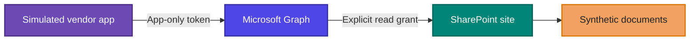
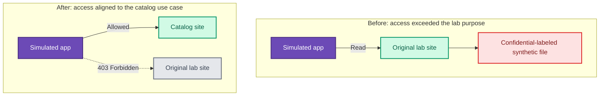

# Third-Party SaaS Access Review Lab


**Third-party risk · Identity and access review · OAuth app permissions · Data classification · Audit evidence · Least privilege**

I assessed a simulated vendor integration in a controlled Microsoft 365 tenant by testing what its application identity could actually read in SharePoint. The app reached a synthetic confidential-labeled file beyond its stated catalog purpose. I moved its site-level grant to the catalog site, then verified that the intended catalog read still worked and the original-site request was denied.

> **The key finding:** permission review is not complete until the effective data reach is tested. In this lab, a `Sites.Selected` grant still exposed more data than the simulated integration needed.

## Assessment snapshot

| Scope | Evidence-based result |
| --- | --- |
| **Environment** | Personal Microsoft 365 trial tenant with fictional SharePoint content |
| **Identity** | One simulated vendor app using app-only authentication through its service principal |
| **Access model** | Microsoft Graph `Sites.Selected` with explicit site-level read grants |
| **Data model** | Two SharePoint sites and three sensitivity tiers: public, internal, and confidential-labeled |
| **Before remediation** | The app listed files and retrieved a synthetic confidential-labeled finance simulation from the original site |
| **After remediation** | Catalog read succeeded; the original-site request returned `403 Forbidden` |
| **Monitoring result** | Entra sign-ins were visible; file-level audit evidence and retention could not be confirmed |

All lab documents used fictional content and made-up values.

## What I delivered

- **Mapped the access path:** Entra app registration → service principal → app-only token → Microsoft Graph → explicit SharePoint site grant.
- **Tested effective reach:** used Microsoft Graph PowerShell to list and retrieve files as the application identity.
- **Compared reach to purpose:** identified that a simulated catalog integration could also read a confidential-labeled finance simulation.
- **Reduced access:** removed the original-site grant and granted read access to the catalog site.
- **Verified both outcomes:** confirmed the catalog remained readable and the original site returned `403 Forbidden`.
- **Separated authentication from audit evidence:** confirmed service-principal sign-ins but did not treat them as proof of a specific file read.

## Access boundary



### Access before and after



## Assessment method

### 1. Identify the vendor identity and grant

I registered an Entra application and reviewed the tenant's corresponding service principal. The app used app-only authentication, meaning the application requested access as itself rather than through a signed-in user's permissions. Its `Sites.Selected` application permission was paired with an explicit site-level read grant.

### 2. Test the resource, not just the permission label

I used Microsoft Graph PowerShell to inspect the selected site's permissions, enumerate files, and retrieve a synthetic file. A sanitized example of the read-only listing check:

```powershell
$siteId = "<LAB_SITE_ID>"
$uri = "https://graph.microsoft.com/v1.0/sites/$siteId/drive/root/children"
$files = Invoke-MgGraphRequest -Method GET -Uri $uri
$files.value | Select-Object name, id
```

The assessment used these Microsoft Graph request patterns:

```http
GET /v1.0/sites/{site-id}/permissions
GET /v1.0/sites/{site-id}/drive/root/children
GET /v1.0/sites/{site-id}/drive/items/{item-id}/content
```

The permission request inspects site grants, the children request lists files, and the content request retrieves a file. IDs shown here are placeholders.

### 3. Map data sensitivity to demonstrated reach

| Fictional content | Tier | Role in the test |
| --- | --- | --- |
| Product catalog | **Public** | The simulated integration's intended use case |
| Operations notes | **Internal** | A higher sensitivity tier in the lab inventory |
| Finance simulation | **Confidential-labeled** | Tested whether the app's reach exceeded its purpose |

The finding was based on the data the application could retrieve, not on the permission name alone.

### 4. Review available monitoring evidence

Entra showed successful service-principal sign-ins. A sign-in confirms that the application authenticated; it does not identify which SharePoint file it read. I could not confirm a matching file-level audit event or establish its retention.

The audit configuration query returned `UnifiedAuditLogIngestionEnabled: False`. Microsoft documents that this property can return `False` even when auditing is enabled, so I treated that value as inconclusive rather than proof that audit ingestion was disabled. The detailed assessment is in [findings.md](findings.md).

### 5. Reduce access and verify the boundary

I removed the app's read grant to the original lab site and granted read access to the separate catalog site. I then repeated the Graph tests:

| Retest | Result |
| --- | --- |
| Read the fictional product catalog | **Allowed** |
| Read the original lab site | **Denied — `403 Forbidden`** |

## Findings

| ID | Finding | Disposition |
| --- | --- | --- |
| **VRA-01** | The original site grant let the app retrieve confidential-labeled synthetic content beyond its fictional catalog purpose. | Removed the original grant; moved access to the catalog site; verified the original path was denied. |
| **OBS-01** | File-level audit coverage and retention could not be confirmed from the available evidence. | Recorded as unverified; the configuration query alone was inconclusive. |

Priority reflects demonstrated reach and sensitivity in this controlled exercise. It is not a production risk rating. See **[the detailed findings](findings.md)** for evidence, rationale, and recommendations.

## Evidence gallery

Each section expands to show full-size evidence. Select an image to open it at its original size.

<details>
<summary><strong>Lab setup and synthetic data</strong></summary>

### Entra tenant baseline
<a href="screenshots/01-entra-baseline.png"></a>

### SharePoint lab site created
<a href="screenshots/01-sharepoint-lab-site-created.png"></a>

### Private site starting state
<a href="screenshots/02-private-site-home-empty.png"></a>

### Synthetic data inventory
<a href="screenshots/03-synthetic-data-inventory.png"></a>

</details>

<details>
<summary><strong>Grant and app-only access test</strong></summary>

### Site-scoped read grant
<a href="screenshots/04-site-scoped-read-grant.png"></a>

### App-only request context
<a href="screenshots/05-app-only-site-read-test.png"></a>

### Files visible to the simulated app
<a href="screenshots/06-vendor-app-visible-files.png"></a>

### Confidential-labeled synthetic file read
<a href="screenshots/07-vendor-app-read-confidential-simulation.png"></a>

</details>

<details>
<summary><strong>Monitoring, remediation, and retest</strong></summary>

### Entra service-principal sign-in
<a href="screenshots/08-service-principal-sign-in-log.png"></a>

### Audit investigation
<a href="screenshots/09-audit-ingestion-disabled.png"></a>

### Catalog access after reduction
<a href="screenshots/10-vendor-app-read-catalog-site.png"></a>

### Final boundary test
<a href="screenshots/11-vendor-app-boundary-test.png"></a>

</details>

## Reproduce the exercise

1. Use a Microsoft 365 tenant you own or are authorized to assess.
2. Create two SharePoint lab sites and add fictional documents only.
3. Register a test app and configure the minimum permissions required for the exercise.
4. Grant read access to one site and test file listing and retrieval in an app-only context.
5. Record the data reached and the monitoring evidence you can verify.
6. Remove the first grant, grant access to the intended catalog site, and retest both allowed and denied paths.

Keep credentials outside source control and revoke lab credentials when they are no longer needed.

## Terminology

| Term | Meaning in this assessment |
| --- | --- |
| **Microsoft Entra ID** | Microsoft's identity service, where the app was registered and sign-ins were reviewed. |
| **App registration** | The application's definition, including its configured API permissions. |
| **Service principal** | The application's identity in this tenant. |
| **App-only access** | The application acts as itself, without a user acting on its behalf. |
| **Microsoft Graph** | The API used to inspect site permissions and test file access. |
| **SharePoint site** | A workspace that stores documents and collaboration content. |
| **`Sites.Selected`** | An app permission that requires an explicit grant to each selected site. |
| **`403 Forbidden`** | The response observed when the app requested the original site after its grant was removed. |
| **Audit coverage** | Whether relevant activity can be found and its retention established. A sign-in alone does not prove a specific file read was logged. |

## References

- [Selected permissions in OneDrive and SharePoint](https://learn.microsoft.com/en-us/graph/permissions-selected-overview)
- [List site permissions with Microsoft Graph](https://learn.microsoft.com/en-us/graph/api/site-list-permissions?view=graph-rest-1.0)
- [Create a site permission with Microsoft Graph](https://learn.microsoft.com/en-us/graph/api/site-post-permissions?view=graph-rest-1.0)
- [Search the audit log in Microsoft Purview](https://learn.microsoft.com/en-us/purview/audit-search)
- [Microsoft 365 audit log activities for SharePoint](https://learn.microsoft.com/en-us/purview/audit-log-activities)
