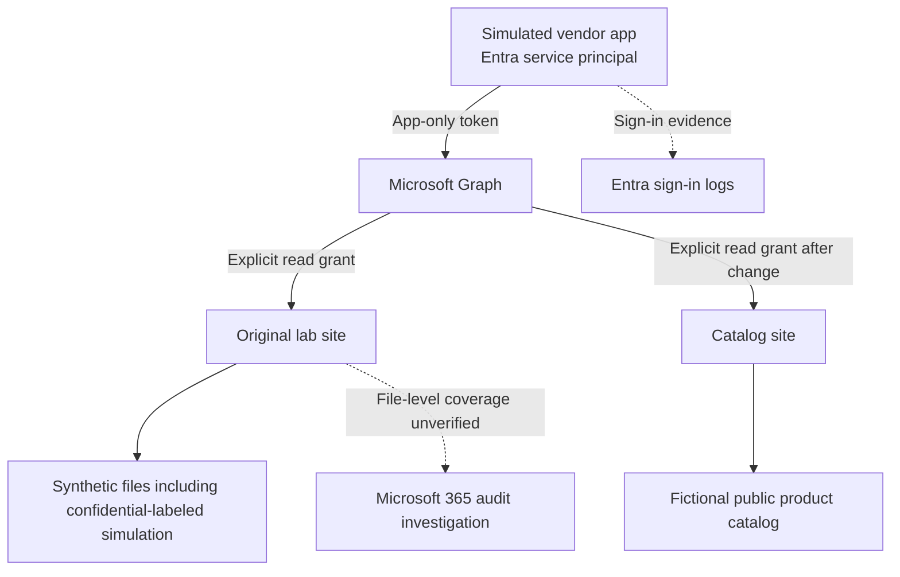
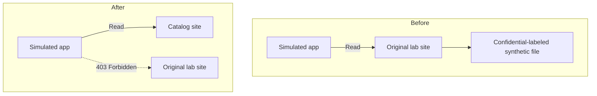

# Third-Party SaaS Access Review Lab

**Microsoft 365 · Microsoft Entra ID · SharePoint Online · Microsoft Graph · OAuth application permissions · Access review · Audit evidence**

> **Review question:** Given a simulated vendor application access to SharePoint, what could it actually read, could its access be narrowed, and what evidence could confirm its activity?

## Executive summary

I built a controlled Microsoft 365 lab with two SharePoint sites, fictional documents, and an Entra application called **Simulated Vendor Integration - Lab**. The app used app-only authentication and Microsoft Graph `Sites.Selected` with explicit site-level read grants.

Before remediation, the app could list files on the original lab site and read a synthetic file labeled **CONFIDENTIAL**. I removed its grant to that site, granted it read access to a separate site containing a fictional public product catalog, and tested both paths again. The catalog request succeeded; a request to the original site returned **403 Forbidden**.

Entra showed successful application sign-ins. I could not confirm a file-level audit event for the test read or establish its retention, so file-level audit coverage is recorded as **unverified**. A configuration query returned `UnifiedAuditLogIngestionEnabled: False`, but Microsoft documents that this property can return `False` even when auditing is enabled; I do not treat that value alone as proof that audit ingestion was disabled ([Microsoft Learn](https://learn.microsoft.com/en-us/purview/audit-log-search-for-mailbox-activities)).

**Environment:** personal Microsoft 365 trial tenant. **All lab documents contained fictional data.**

## What I tested

| Test | Evidence and result |
| --- | --- |
| Identify the effective grant | Reviewed the app's `Sites.Selected` application permission and its explicit site-level read grant. |
| Test reach before remediation | Listed files and retrieved a fictional confidential-labeled finance simulation from the original lab site. |
| Review available monitoring evidence | Confirmed Entra service-principal sign-ins; could not confirm a file-level audit event or retention. |
| Reduce access | Removed the original site grant and granted read access to a separate catalog site. |
| Retest both paths | The catalog remained readable; the original site returned `403 Forbidden`. |

## Architecture



### Access boundary before and after



## How the lab worked

### 1. Set up a controlled data environment

I created two SharePoint sites and used made-up test documents to represent different sensitivity tiers. The finance simulation explicitly contained no real financial, customer, or personal data.

- `PUBLIC-Product-Catalog.txt` — fictional public catalog data
- `INTERNAL-Operations-Notes.txt` — fictional internal notes
- `CONFIDENTIAL-Finance-Simulation.txt` — fictional finance summary with made-up values

### 2. Set up the simulated vendor identity

I registered an Entra application and used its service principal as the vendor identity. The app used app-only authentication: it requested Microsoft Graph access as itself, without a user acting on its behalf. `Sites.Selected` was paired with an explicit site-level read grant.

### 3. Tested the effective access path

The permission label alone did not tell me what the app could reach, so I tested the SharePoint resource using Microsoft Graph PowerShell. After connecting as the lab app (with credentials kept outside the repository), I used a sanitized version of this read-only check:

```powershell
$siteId = "<LAB_SITE_ID>"
$uri = "https://graph.microsoft.com/v1.0/sites/$siteId/drive/root/children"
$files = Invoke-MgGraphRequest -Method GET -Uri $uri
$files.value | Select-Object name, id
```

I also tested whether the app could retrieve the synthetic confidential-labeled file. The requests followed these Graph patterns:

```http
GET /v1.0/sites/{site-id}/permissions
GET /v1.0/sites/{site-id}/drive/root/children
GET /v1.0/sites/{site-id}/drive/items/{item-id}/content
```

The first request inspects site permissions; the second lists files; the third retrieves a file's content. IDs are placeholders here. No credentials, access tokens, or tenant-specific IDs are stored in this repository.

### 4. Reviewed monitoring evidence

Entra contained successful service-principal sign-in events. I also checked whether the available audit evidence could confirm the synthetic file read. I could not establish a matching file-level event or verify retention. The tenant configuration query returned `False`, but that property is not conclusive by itself; the result is therefore recorded as **unverified file-level audit coverage**, not as proof that every logging source was disabled.

### 5. Reduced and retested access

I removed the app's read grant to the original site, granted it read access to the catalog site, and repeated the Graph requests. The app could read the fictional catalog, while its request to the original site was denied with `403 Forbidden`. This demonstrated the access reduction in the lab.

## Findings

See **[findings.md](findings.md)** for the detailed assessment record.

| ID | Finding | Disposition |
| --- | --- | --- |
| **VRA-01** | The app's original site-level read grant allowed it to retrieve confidential-labeled synthetic content, beyond the fictional public-catalog purpose. | Removed the original grant, granted access to the catalog site, and verified the original path was denied. |
| **OBS-01** | File-level audit coverage and retention could not be confirmed from the available evidence. | Recorded as unverified; the configuration query alone was not treated as proof that auditing was disabled. |

The access finding is prioritized by demonstrated resource reach and data sensitivity in this lab, rather than by the permission name alone. These are lab findings, not production risk ratings.

## Evidence gallery

The images below document the controlled lab setup, access tests, monitoring review, and remediation.

### Environment and test data

#### Entra tenant baseline


#### SharePoint lab site created


*The lab site appears in the tenant's active sites. Its fictional site name and relative path remain visible.*

#### Initial private SharePoint site


*The starting state of the private lab site.*

#### Synthetic data inventory


*Fictional public, internal, and confidential-labeled files used in the test.*

### Grant and app-only access test

#### Site-scoped read grant


*PowerShell evidence of the explicit site-level read grant.*

#### App-only request context


*The app-only authentication context and Graph request. The fictional lab site name remains visible.*

#### Files visible to the simulated app


*The app enumerated the synthetic files on the granted site.*

#### Confidential-labeled synthetic file read


*The app retrieved the made-up finance simulation before the grant was reduced.*

### Monitoring and remediation evidence

#### Entra service-principal sign-in


*Successful sign-in evidence for the simulated application.*

#### Audit investigation


*The available tenant audit evidence did not establish a file-level event or retention. The displayed configuration value is not treated as conclusive by itself.*

#### Catalog access after reduction


*The app could enumerate the fictional catalog after receiving its new site-level grant.*

#### Final boundary test


*The catalog request succeeded and the original-site request returned `403 Forbidden`.*

## Terminology

| Term | Meaning in this lab |
| --- | --- |
| **Microsoft Entra ID** | Microsoft's identity service, where the application was registered and its sign-in events were reviewed. |
| **App registration** | The application's definition, including its configured API permissions. |
| **Service principal** | The application's identity in this tenant. |
| **App-only access** | The application acts as itself rather than using a signed-in user's identity. |
| **Microsoft Graph** | Microsoft's API used here to inspect site permissions and test file access. |
| **SharePoint site** | A workspace that stores documents and collaboration content. |
| **`Sites.Selected`** | A Graph application permission that requires an additional explicit grant to each selected site. |
| **`403 Forbidden`** | The observed response when the app requested the original site after its grant was removed. |
| **Audit coverage** | Whether relevant events can be found and their retention verified. A sign-in event alone does not prove a specific file read was logged. |

## Reproducing the exercise

1. Use a Microsoft 365 tenant you own or are authorized to assess.
2. Create two lab SharePoint sites and add fictional documents only.
3. Register a test app and configure the minimum permissions required for the exercise.
4. Grant the app read access to the first site and test file listing and reading in an app-only context.
5. Record what data the app could actually reach and what monitoring evidence you can verify.
6. Remove the first grant, grant access to the intended catalog site, and test both allowed and denied paths again.

Keep credentials outside source control and revoke lab credentials when they are no longer needed.

## References

- [Selected permissions in OneDrive and SharePoint](https://learn.microsoft.com/en-us/graph/permissions-selected-overview)
- [List site permissions with Microsoft Graph](https://learn.microsoft.com/en-us/graph/api/site-list-permissions?view=graph-rest-1.0)
- [Create a site permission with Microsoft Graph](https://learn.microsoft.com/en-us/graph/api/site-post-permissions?view=graph-rest-1.0)
- [Search the audit log in Microsoft Purview](https://learn.microsoft.com/en-us/purview/audit-search)
- [Microsoft 365 audit log activities for SharePoint](https://learn.microsoft.com/en-us/purview/audit-log-activities)
