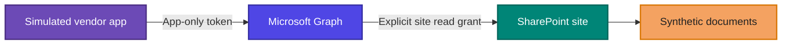

# Third-Party SaaS Access Review Lab


> **The question:** What can a simulated vendor application actually read, does that match its purpose, and can a narrower grant be proven to work?

I built a controlled Microsoft 365 lab to review a simulated vendor integration as an access boundary. The application used app-only authentication and Microsoft Graph `Sites.Selected`. I tested its real SharePoint reach against fictional files, reduced its access, and retested both the allowed and denied paths.

**Lab result:** the app could read a synthetic confidential-labeled file before remediation. After I moved its site-level read grant to a fictional product-catalog site, catalog access succeeded and access to the original site returned **`403 Forbidden`**.

---

## ✨ Project at a glance

| | |
| --- | --- |
| **Environment** | Personal Microsoft 365 trial tenant |
| **Identity under review** | Entra app registration and its service principal |
| **Authentication** | App-only OAuth flow; no user acting on behalf of the app |
| **Access model** | Microsoft Graph `Sites.Selected` plus explicit site-level read grants |
| **Test data** | Fictional public, internal, and confidential-labeled documents |
| **Outcome** | Removed the unnecessary original-site grant; verified intended catalog access and a denied request to the original site |
| **Audit result** | Entra service-principal sign-ins were visible; file-level audit evidence and retention could not be confirmed |

> **All documents in the lab were fictional.** The confidential-labeled finance summary used made-up values and contained no real financial, customer, or personal data.

## 🧭 The assessment flow

| Step | What I did | Why it matters |
| --- | --- | --- |
| **01 · Create** | Set up two SharePoint sites and synthetic files at different sensitivity tiers. | Gives the review a controlled data boundary. |
| **02 · Grant** | Configured the simulated app with `Sites.Selected` and an explicit read grant. | The permission name alone does not show which site is reachable. |
| **03 · Test** | Used Microsoft Graph to list and retrieve files as the app. | Measures effective access instead of inferring it from configuration. |
| **04 · Observe** | Reviewed Entra service-principal sign-ins and attempted to confirm file-level audit evidence. | Separates authentication evidence from proof of a specific file read. |
| **05 · Reduce** | Removed the original-site grant and granted read access to the catalog site. | Aligns access with the simulated app's stated purpose. |
| **06 · Retest** | Confirmed catalog access still worked and the original-site request was denied. | Validates both expected access and the boundary after the change. |

## 🏗️ How the access boundary worked



### Before and after the access change


## 🔎 What I tested

### 1. The vendor identity

I registered an Entra application and used its tenant service principal as the simulated vendor identity. In the app-only flow, the application requests access as itself rather than acting through a signed-in user's permissions.

### 2. The effective SharePoint reach

I reviewed the app's `Sites.Selected` application permission and explicit site-level grants, then tested SharePoint through Microsoft Graph PowerShell. A sanitized example of the read-only file-list check:

```powershell
$siteId = "<LAB_SITE_ID>"
$uri = "https://graph.microsoft.com/v1.0/sites/$siteId/drive/root/children"
$files = Invoke-MgGraphRequest -Method GET -Uri $uri
$files.value | Select-Object name, id
```

The test followed these Microsoft Graph request patterns:

```http
GET /v1.0/sites/{site-id}/permissions
GET /v1.0/sites/{site-id}/drive/root/children
GET /v1.0/sites/{site-id}/drive/items/{item-id}/content
```

The first request inspects site permissions, the second lists files, and the third retrieves file content. IDs above are placeholders.

### 3. The data classification boundary

| Synthetic file | Lab tier | Test purpose |
| --- | --- | --- |
| `PUBLIC-Product-Catalog` | **Public** | The app's intended catalog use case |
| `INTERNAL-Operations-Notes` | **Internal** | Illustrates a higher sensitivity tier |
| `CONFIDENTIAL-Finance-Simulation` | **Confidential** | Tests whether app reach exceeds the fictional purpose |

The app's ability to retrieve the confidential-labeled simulation demonstrated why actual resource reach matters more than the permission label alone.

### 4. The monitoring evidence

Entra contained successful service-principal sign-in events. A sign-in proves the application authenticated; it does not identify which SharePoint file it read. I could not confirm a matching file-level audit event or verify retention from the available evidence.

The audit configuration query returned `UnifiedAuditLogIngestionEnabled: False`. Microsoft documents that this property can return `False` even when auditing is enabled, so I treated the value as **inconclusive**, not proof that audit ingestion was disabled. The detailed observation is in [findings.md](findings.md).

### 5. The access reduction

I removed the application's read grant to the original lab site and granted read access to the separate catalog site. Afterward:

- ✅ The simulated app could read the fictional catalog.
- ⛔ The request to the original site returned **`403 Forbidden`**.

This verifies both the intended path and the denied path in the lab.

## 📌 Findings summary

| ID | Finding | Priority in this lab | Result |
| --- | --- | --- | --- |
| **VRA-01** | The original site-level read grant let the app retrieve confidential-labeled synthetic content beyond its fictional catalog purpose. | **High** | Original grant removed; catalog grant tested; original-site request denied. |
| **OBS-01** | File-level audit coverage and retention could not be confirmed from available evidence. | **Evidence gap** | Recorded as unverified; the configuration query alone was inconclusive. |

The priority reflects demonstrated resource reach and data sensitivity in this controlled exercise. It is not a production risk rating. See **[the detailed findings](findings.md)** for evidence, rationale, and recommendations.

## 🖼️ Evidence gallery

Screenshots are grouped by the part of the assessment they support. Select an image to view it at full size.

<details open>
<summary><strong>01 · Lab setup and synthetic data</strong></summary>

<br>

| Tenant baseline | SharePoint site | Private site starting state |
| --- | --- | --- |
| <a href="screenshots/01-entra-baseline.png"></a> | <a href="screenshots/01-sharepoint-lab-site-created.png"></a> | <a href="screenshots/02-private-site-home-empty.png"></a> |

| Synthetic data inventory |
| --- |
| <a href="screenshots/03-synthetic-data-inventory.png"></a> |

</details>

<details open>
<summary><strong>02 · Grant and app-only access test</strong></summary>

<br>

| Site-scoped read grant | App-only request context | Files visible to the app |
| --- | --- | --- |
| <a href="screenshots/04-site-scoped-read-grant.png"></a> | <a href="screenshots/05-app-only-site-read-test.png"></a> | <a href="screenshots/06-vendor-app-visible-files.png"></a> |

| Confidential-labeled synthetic file read |
| --- |
| <a href="screenshots/07-vendor-app-read-confidential-simulation.png"></a> |

</details>

<details open>
<summary><strong>03 · Monitoring, remediation, and retest</strong></summary>

<br>

| Entra service-principal sign-in | Audit investigation | Catalog access after reduction |
| --- | --- | --- |
| <a href="screenshots/08-service-principal-sign-in-log.png"></a> | <a href="screenshots/09-audit-ingestion-disabled.png"></a> | <a href="screenshots/10-vendor-app-read-catalog-site.png"></a> |

| Final boundary test |
| --- |
| <a href="screenshots/11-vendor-app-boundary-test.png"></a> |

</details>

## 🧪 Reproduce the exercise

1. Use a Microsoft 365 tenant you own or are authorized to assess.
2. Create two SharePoint lab sites and add fictional documents only.
3. Register a test app and configure the minimum permissions required for the exercise.
4. Grant read access to one site and test file listing and retrieval in an app-only context.
5. Record the data reached and what monitoring evidence you can verify.
6. Remove the first grant, grant access to the intended catalog site, and retest both allowed and denied paths.

Keep credentials outside source control and revoke lab credentials when they are no longer needed.

## 📚 Quick glossary

| Term | Meaning here |
| --- | --- |
| **Microsoft Entra ID** | Microsoft's identity service, where the app was registered and sign-ins were reviewed. |
| **App registration** | The application's definition, including configured API permissions. |
| **Service principal** | The app's identity in this tenant. |
| **App-only access** | The application acts as itself, without a user acting on its behalf. |
| **Microsoft Graph** | The API used to inspect site permissions and test file access. |
| **SharePoint site** | A workspace that stores documents and collaboration content. |
| **`Sites.Selected`** | An app permission that requires an explicit grant to each selected site. |
| **`403 Forbidden`** | The response observed when the app requested the original site after its grant was removed. |
| **Audit coverage** | Whether relevant activity can be found and its retention established. A sign-in alone does not prove a specific file read was logged. |

## 🔗 References

- [Selected permissions in OneDrive and SharePoint](https://learn.microsoft.com/en-us/graph/permissions-selected-overview)
- [List site permissions with Microsoft Graph](https://learn.microsoft.com/en-us/graph/api/site-list-permissions?view=graph-rest-1.0)
- [Create a site permission with Microsoft Graph](https://learn.microsoft.com/en-us/graph/api/site-post-permissions?view=graph-rest-1.0)
- [Search the audit log in Microsoft Purview](https://learn.microsoft.com/en-us/purview/audit-search)
- [Microsoft 365 audit log activities for SharePoint](https://learn.microsoft.com/en-us/purview/audit-log-activities)

---

<p align="center"><sub>Controlled lab · Fictional data · Least privilege · Evidence-based access review</sub></p>
